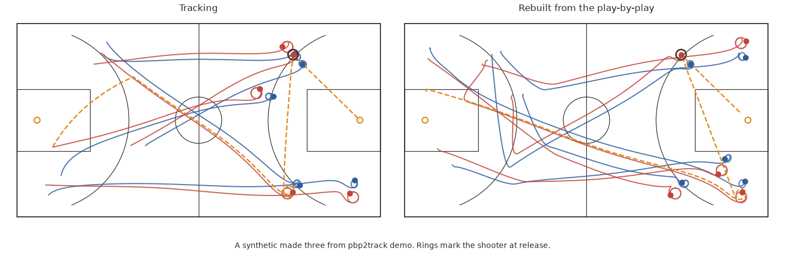

# pbp2track

Rebuild player and ball tracking for any pro basketball game since 1996-97 from its play-by-play.

A play-by-play log says who shot, from where, when, and what happened next. pbp2track turns that log into ten moving players and a ball at 25 frames a second. It does it by motion matching: every logged possession is matched to a real tracked possession with the same outcome, shot spot, shot type and length, then fitted to the log. The shooter stands on the logged spot at release. The ball goes through the rim on a make. The rebounder ends at the ball.

The library comes from the 609 games of 2015-16 SportVU tracking: 108,602 possessions. The play-by-play reaches back to 1996-97, so every game since then can be rebuilt.

pbp2track powers Ghost Broadcast, a Fire TV app that plays these rebuilt games in 3D.

## Try it

```bash
pip install "pbp2track[parquet] @ git+https://github.com/rapha18th/pbp2track"
pbp2track demo
```

`demo` invents a small league, builds a possession library from its tracking, rebuilds two held-out games from their play-by-play and scores them against their own tracking. It runs on invented data in under a minute.



## How it works

1. **Possessions from the log.** The game clock splits the play-by-play into possessions. A made field goal, a defensive rebound, a turnover or a last made free throw ends one. Each possession carries its outcome, length, shooter, assister, rebounder, turnover player, legacy shot coordinates, shot family (rim, hook, jump) and the outcome before it.
2. **Lineups from substitutions.** A period's starters are the first five players of each team who act, or leave in a substitution, before entering one. Substitutions then apply row by row. Older `SUB: X FOR Y` rows name the incoming player by surname, resolved through the game's own rows. Newer `in` and `out` rows pair up at the same clock. A short lineup borrows from the previous period.
3. **Retrieval.** Library possessions with the same outcome are ranked by cost, and the cheapest clip wins. The cost adds the distance between shot spots in feet; 6 for a different shot family; 0.6 per second of length difference; 3 when only one of the two follows a defensive rebound; 2 when only one follows a turnover; 25 for a clip used in the last 12 possessions.
4. **Role assignment.** The clip's shooter becomes the logged shooter. The assister, the turnover player and the rebounder take their clip roles too. Everyone else goes to the slot that keeps their travel from the end of the last possession smallest, searched over every permutation.
5. **Time warp.** The clip is resampled to the logged length, at a ratio held between 0.75 and 1.35. A longer possession holds its opening shape. A shorter one loses its start. The ending always lines up with the logged event.
6. **Shot pinning.** The shooter slides onto the logged shot spot over the 60 frames before release. Teammates follow by a quarter of the shift, the closest defender by 70 percent, the other defenders by a quarter. The ball moves with the shooter until release, then eases back onto its real flight to the rim.
7. **Attack direction.** The home team attacks the +x hoop in the first half and the -x hoop after, or per period when the real direction is known. Each clip is mirrored to fit.
8. **Stitching.** Each player blends from where the last possession left them over 18 frames. Events get frames by their share of the possession clock. The shot event sits 10 frames after release.

Legacy shot coordinates (tenths of a foot from the hoop) map to court feet with a sign and offset fit on the library: `x = 88.75 - ylegacy/10 + dx`, `y = 25 + xlegacy/10 + dy`.

## Evaluation

Forty games with real tracking were held out of the library, rebuilt from their play-by-play alone and compared with their own tracking at every matched shot release. The library held 75,322 clips from a 90,000-possession sample of the other games. The baseline draws a random library possession with the same outcome and leaves it unpinned.

| 40 held-out games, 4,548 shots | pbp2track | Baseline | Real |
|---|---|---|---|
| Shooter position at release, median error | **3.38 ft** | 17.11 ft | |
| Shooter position at release, 90th percentile | 13.11 ft | 32.6 ft | |
| Player speed, mean | **6.26 ft/s** | 4.91 ft/s | 6.28 ft/s |
| Player speed, KS distance to real | **0.028** | 0.214 | |
| Closest defender to the shooter, mean absolute error | **2.99 ft** | 3.65 ft | |
| Offensive spacing, convex hull of the five | 503.7 sq ft | 506.3 sq ft | 508.7 sq ft |
| Sampled frames with two players within 1 ft | 7.2% | 7.7% | 6.8% |

The shooter error sits at the floor the log allows. Legacy shot coordinates lie a median 3.32 ft from the tracked release spot across 57,722 library shots, so even a perfect pin lands a median 3.32 ft away. The baseline matched 4,392 shots.

These figures come from the Ghost Broadcast held-out run of the same reconstruction code (its `p3_eval.json`). `evaluate` picks the same 40 games. Run it on Kaggle with `kaggle/heldout_eval.py`, or locally:

```bash
pbp2track evaluate --library LIBRARY_DIR --games 40 --seed 7 --include 0021500438 --max-clips 90000 --out eval.json
```

## Get the data

The data stays outside this repository. Download it yourself and respect each licence.

| Source | What it gives | Licence |
|---|---|---|
| [NBA Stats Dataset: 1996 - Present](https://www.kaggle.com/datasets/chevronronson/nba-stats-dataset) by chevronronson (Kaggle) | Play-by-play from 1996-97 to 2025-26 with playoffs, legacy shot coordinates, and `action_number`, which matches the SportVU event id | CC0 1.0 |
| SportVU 2015-16 game logs (STATS LLC), research copy at [linouk23/NBA-Player-Movements](https://github.com/linouk23/NBA-Player-Movements) | 25 Hz tracking of ten players and the ball: the library and the evaluation | None stated. The logs belong to STATS LLC. Use them for research and keep them out of public repositories |
| [NBA Play-by-Play Data](https://www.kaggle.com/datasets/szymonjwiak/nba-play-by-play-data-1997-2023) by Szymon Jóźwiak (Kaggle), optional | A second play-by-play for cross-checks | CC BY-NC-SA 4.0 |

Build the library on Kaggle, where the play-by-play already lives:

1. Create a notebook, add the chevronronson dataset, turn Internet on.
2. Paste `kaggle/build_library.py` and run it. It installs pbp2track and py7zr, clones the SportVU copy and writes the library to `/kaggle/working`: `frames/` (one `.npz` per game), `possessions.parquet`, `events.parquet`, `rosters.parquet` and `games.csv`.
3. Add that notebook's output as the input of a second notebook and run `kaggle/heldout_eval.py` for the numbers above.

Offline notebooks can run one bundled file: `python tools/bundle_kernel.py kaggle/heldout_eval.py out.py` packs the package into the script.

To work locally, fetch both with the Kaggle CLI:

```bash
kaggle datasets download chevronronson/nba-stats-dataset --unzip -p nba-stats
kaggle kernels output <you>/<library-notebook> -p LIBRARY_DIR
```

## Rebuild a game

```bash
pbp2track rebuild --library LIBRARY_DIR --pbp nba-stats/csv/play_by_play.csv --game 0020500591 --out rebuilt/0020500591
```

The home and away teams come from the log's `game_matchup`. Pass `--home` and `--away` team ids when it is missing. The command writes two files.

`<out>.npz`

| Array | Shape | Meaning |
|---|---|---|
| `pos` | (n, 23) | Ball x, y, z, then x, y for the home five and the away five, in feet |
| `gc` | (n,) | Game clock, seconds left in the period |
| `sc` | (n,) | Shot clock |
| `q` | (n,) | Period |

`<out>.json` holds `lineups` (player ids for each frame range, home five first), `events` (each log row with its frame), `pinned` (frames where a logged fact holds a player) and `possessions` (the clip used and its retrieval cost).

The court is 94 by 50 ft with the hoops at (5.25, 25) and (88.75, 25), the SportVU frame.

## Python

```python
from pbp2track import Library, names_from_pbp, reconstruct_game, save_rebuild
from pbp2track.sportvu import read_pbp

lib = Library("LIBRARY_DIR", max_clips=90_000).build()
lib.legacy_to_court()

game = read_pbp("nba-stats/csv/play_by_play.csv", [20500591])  # reads the big CSV in chunks
rec = reconstruct_game(game, home_id=1610612747, away_id=1610612761, lib=lib, names=names_from_pbp(game))
save_rebuild(rec, "rebuilt/0020500591")
```

`examples/rebuild_one_game.py` runs the same steps. Run bare, it uses a synthetic league.

## Build a library from other tracking

`pbp2track build-library --sportvu LOGS_DIR --pbp play_by_play.csv --out LIBRARY_DIR --workers 4 --game-range 21500001 21501230`

Any tracking that can be written as SportVU-style JSON works: `{"gameid", "events": [{"home", "visitor", "moments"}]}`, each moment `[period, unix ms, game clock, shot clock, null, [[team id, player id, x, y, z], ...]]` with team id -1 for the ball. `pbp2track.synth` writes this format and is a working example.

## Context

The sports analytics literature calls a simulated player a ghost. Le, Carr, Yue and Lucey trained deep imitation learning on a season of professional soccer tracking to show where a league-average defence would stand ("Data-Driven Ghosting using Deep Imitation Learning", MIT Sloan Sports Analytics Conference 2017). pbp2track asks for less input: the event log alone. It rebuilds all ten players and the ball by retrieval over real possessions.

Motion matching comes from game animation, where Simon Clavet presented it for Ubisoft at GDC 2016 ("Motion Matching and The Road to Next-Gen Animation"). A character picks the clip of captured motion that best fits what it must do next. pbp2track does the same with possessions.

## Limitations

- One season of motion. Every rebuilt game moves like 2015-16 basketball, whatever its year.
- Facts the log records are honoured. The rest is borrowed from a similar real possession: off-ball cuts, screens and defensive schemes are plausible, and they are guesses.
- Stopped-clock time takes its length from the matched clip. Timeouts and reviews between possessions become a cut.
- Possessions end on a made shot, a defensive rebound, a turnover or a last made free throw. An offensive rebound extends its possession, so the motion after it comes from the same clip.
- The library carries 2015-16 player ids. Roles are retargeted by slot, so a rebuilt player runs another player's path.
- A `SUB: X FOR Y` row resolves the incoming player by surname within the same game. A player whose only row is that substitution stays unresolved, and possessions are dropped until the lineup holds five again.
- Shot positions rest on legacy shot coordinates, which carry a median 3.32 ft of error against tracking.

## Development

```bash
pip install -e ".[all]"
pytest
```

The tests run on a synthetic league generated by `pbp2track.synth` and use invented data only. See [CONTRIBUTING.md](CONTRIBUTING.md).

## Licence

MIT for the code, see [LICENSE](LICENSE). The datasets keep their own licences, listed above. pbp2track is an independent project, unaffiliated with the NBA, its teams or STATS LLC.
